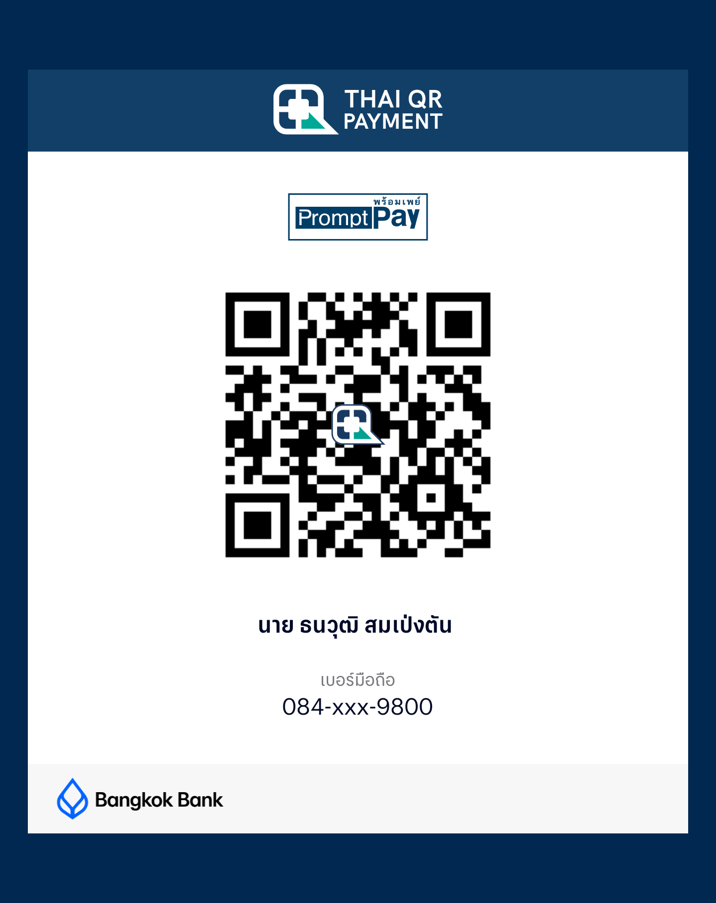

[ภาษาไทย](README.md) · **English**

# VoltaChill

A diagnostics and battery charge-temperature monitor for the **BYD ATTO 3**, written in Rust + egui
(eframe). It talks to the car through an **ELM327 Bluetooth LE** OBD adapter.

- One codebase, three targets: **Android phone** (portrait), **DiLink head unit**
  (Android 10, landscape) and **macOS** (desktop).
- Thai and English UI.
- Version 0.2.0 · by M1TS.

> ℹ️ **This public build is read-only.** It reads diagnostics, live data, battery health and
> monitors temperatures while charging, but **sends no actuator commands.** The battery
> charge-cooling actuation (fan / pump / cooling, which requires manufacturer security access)
> is **not included here.**
>
> **Use it at your own risk, on a vehicle you own.** The authors accept no liability for any
> damage, loss of warranty, or harm. Not affiliated with or endorsed by BYD.

---

## Contents
1. [Hardware](#hardware)
2. [Features](#features)
3. [Phone vs car build](#phone-vs-car-build)
4. [Scope (read-only)](#scope-read-only)
5. [Architecture](#architecture)
6. [Code layout](#code-layout)
7. [Build](#build)
8. [Data tables (stubs)](#data-tables-stubs)
9. [Files the app writes](#files-the-app-writes)
10. [Support](#support)
11. [License](#license)

---

## Hardware

| Part | Notes |
|---|---|
| Car | BYD ATTO 3 (tested on the 2023 model) |
| OBD reader | **Bluetooth LE** ELM327 (advertised as `OBDII`, GATT service `FFF0`) |
| Phone | Android 7.0+ (minSdk 24), arm64 |
| Head unit | DiLink 3.0 / Android 10 / 1920×1080 / arm64 |
| Desktop | macOS with Bluetooth (btleplug) |

> Note: the DID/PID values and formulas were confirmed directly against a BYD ATTO 3.
> Other makes/models may not work or may report wrong values.

---

## Features

The home screen is a Bluetooth-connect card plus a mosaic of tiles.

| Tile | What it does |
|---|---|
| **Trouble Codes** | Reads DTCs from the car's diagnostic modules, with code description texts (supply your own; see [Data tables](#data-tables-stubs)), and can clear them (with a confirm step) |
| **Live Data** | Dark dashboard: BMS / OBC / vehicle sections, SOC and power dials, temperature and cell-voltage tiles, plus bus-sniffed gear / handbrake / A-C / speed and the 12 V reading |
| **Charge & Cool** | **Monitor only:** thermal status (DC), the BMS thermal-request value, OBC temperatures, PDC coolant / pump / fan status (AC) · live graph · CSV recording (auto-starts while the OBC reports charging) _— no actuator controls in this build_ |
| **Battery** | Pack / voltage / temperature / BMS cards, capacity now vs factory, a 126-cell balancing grid, history chart |
| **Full check** | Five read-only steps (VIN → codes → battery → battery detail → OBC + 12 V) → saved report |
| **VIN** | Reads the VIN from the car and decodes it offline |
| **Report** | Saved reports |
| **Bus Monitor** | Passive CAN frame viewer (ELM327 `ATMA`) |
| **Settings** | Language, units, read-only DID-scan buttons |

**Background work (Android):** while a charge recording is open and the UI goes idle (screen
off / app in the background), a worker keeps reading values and appends to the CSV — backed by
a foreground service and a wake lock.

### Phone vs car build

The Android build has two product flavors (`android/app/build.gradle.kts`):

| | `phone` | `car` |
|---|---|---|
| Layout | portrait, scrollable, 9 tiles | landscape, fits the screen, 4 tiles |
| UI scale | fixed logical width | derived from the home page so it fills the head-unit screen |
| Bottom inset | none | leaves room for the head unit's climate bar |

The car flavor sets `BuildConfig.CAR`, which the Rust side reads via `nativeCarMode`.
Both flavors share one package id, so a device holds one or the other.

---

## Scope (read-only)

**This public build is read-only.** Reading trouble codes, live data, battery, VIN, bus
monitor, DID scan and charge-temperature monitoring never write anything back to the car.
The one exception is clearing trouble codes (clear DTC), which has a confirm step.

The real-hardware actuation (battery cooling / fan / pump), which requires manufacturer
security access, is **not part of this public build** — removed for safety and to reduce
intellectual-property risk.

---

## Architecture

```
 UI thread (egui)                    OBD worker                     car
 ScanApp (app.rs)  ──Cmd──▶  desktop: tokio + btleplug   ──BLE──▶  ELM327  ──CAN──▶  ECUs
 screens / state   ◀──Ev──   android: thread + JNI (Ble.kt)
```

The UI sends `Cmd`s and receives `Ev`s, so it never blocks on the link. For each module the
worker switches the ELM header and flow control (BMS `7E7`, OBC `7E4`, PDC `7E2`). The Bus
Monitor uses `ATMA` silent monitoring between requests.

## Code layout

```
src/
  main.rs       desktop entry
  lib.rs        Android entry (android_main via GameActivity)
  app.rs        UI, scaling/insets, fonts, DID lists, CSV, JNI hooks (mod androidback)
  obd.rs        ELM327 link (desktop btleplug / Android JNI), UDS, DID scan, bus sniff
  sniff.rs      Bus Monitor + signal lookup
  history.rs    battery history / saved reports
  vin.rs        offline VIN decode
  car.rs        OBD-II PIDs, DTC status
  byd_dtc.txt       module list (see Data tables)
  byd_signals.txt   CAN signal table (see Data tables)
android/        Gradle project (GameActivity host, BLE, foreground service)
```

---

## Build

Requires Rust with the `aarch64-linux-android` target and `cargo-ndk`, the Android SDK/NDK,
JDK 17, and (for desktop) macOS with Bluetooth.

### Desktop
```sh
cargo build --release
./target/release/voltachill
cargo test --release      # unit tests
```

### Android
```sh
# 1) Rust -> .so  (always run this after changing Rust code)
cargo ndk -t arm64-v8a build --release --lib
"$ANDROID_NDK_HOME"/toolchains/llvm/prebuilt/*/bin/llvm-strip \
  target/aarch64-linux-android/release/libvoltachill.so \
  -o android/app/src/main/jniLibs/arm64-v8a/libvoltachill.so

# 2) APKs
cd android
./gradlew assemblePhoneRelease assembleCarRelease
#   app/build/outputs/apk/phone/release/app-phone-release.apk
#   app/build/outputs/apk/car/release/app-car-release.apk
```

### Signing (optional)
Release builds are signed only if `~/.android/<name>-signing.properties` exists, with keys
`storeFile`, `storePassword`, `keyAlias`, `keyPassword`. **No keystore or password is stored
in this repo.** Without that file, Gradle still builds (unsigned release / debug key).

---

## Data tables (stubs)

Two embedded files are shipped as **stubs** because the full tables are derived from a third
party and are not redistributable:

- `src/byd_dtc.txt` — keeps the diagnostic **module list** (CAN IDs + names); the DTC
  description texts are removed. Codes still read; they just show without descriptions. Add
  your own `D <req> <code> <text>` lines to restore descriptions.
- `src/byd_signals.txt` — a header only. Add `frame bit page name` rows to name signals in
  the Bus Monitor.

The app builds and runs with the stubs; only those descriptions/names are absent.

Some CAN signal meanings (gear, handbrake, speed, charge state, …) are credited in code
comments to the open-source
[OVMS (Open Vehicle Monitoring System)](https://github.com/openvehicles/Open-Vehicle-Monitoring-System-3)
BYD ATTO 3 module.

---

## Files the app writes

- Android: `/sdcard/Android/data/<app>/files/` (pull with `adb pull`, no permission needed)
- Desktop: `~/Documents/ScanLab/`

| File | Contents |
|---|---|
| `charge_*.csv` | One row per charge poll: SOC, V, A, kW, battery temp, cell min/max, OBC temps, AC V/A/kW, OBC state, coolant, pump, fan |
| `history.csv` | Battery history (for the chart) |
| `balance.csv` | Cell balancing data |
| `reports.txt` | Saved reports |
| `did_scan_*.csv` | DID-scan results from Settings |

---

## Support

VoltaChill is free, open-source software built in my spare time, and will always be free.

If you find it useful and would like to support the developer, you can leave a tip here (PromptPay):

<p align="center">
  
</p>

Or via Ko-fi (for international supporters):

<p align="center">
  <a href="https://ko-fi.com/P3X42AE4IX"></a>
</p>

**This is a purely voluntary gift.** It is not a purchase of any product or service.
Supporters receive **nothing in return** — no extra features, no special access, no warranty,
and no obligation of any kind from the developer. Every feature of the app is free and
identical for everyone, whether they donate or not.

Thank you for stopping by 🙏

---

## License

MIT — see [LICENSE](LICENSE)
