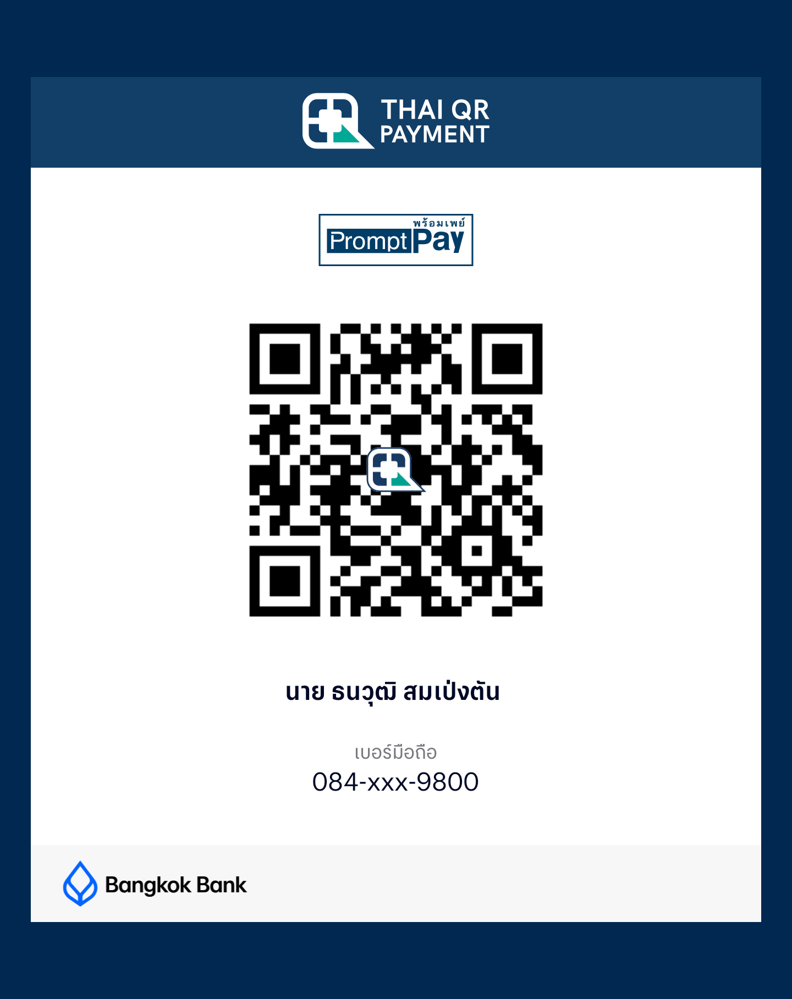

**ภาษาไทย** · [English](README.en.md)

# VoltaChill

แอปวินิจฉัยรถและเฝ้าดูความร้อนแบตเตอรี่ตอนชาร์จ สำหรับ **BYD ATTO 3** เขียนด้วย
Rust + egui (eframe) คุยกับรถผ่านตัวแปลง **ELM327 Bluetooth LE** ที่เสียบช่อง OBD

- โค้ดชุดเดียว รันได้ 3 แพลตฟอร์ม: **มือถือ Android** (แนวตั้ง), **จอรถ DiLink** (Android 10 แนวนอน) และ **macOS** (เดสก์ท็อป)
- UI ภาษาไทยและอังกฤษ
- เวอร์ชัน 0.2.0 · โดย M1TS

> ℹ️ **เวอร์ชันสาธารณะนี้เป็นแบบอ่านอย่างเดียว (read-only)** — อ่านค่าวินิจฉัย ข้อมูลสด
> สุขภาพแบต และเฝ้าดูอุณหภูมิตอนชาร์จ **แต่ไม่ส่งคำสั่งสั่งงานอุปกรณ์ใด ๆ** ส่วนการสั่งทำความเย็นแบต/
> พัดลม/ปั๊ม (ซึ่งต้องใช้การปลดล็อก security access ของผู้ผลิต) **ไม่รวมอยู่ในที่นี้**
>
> **ใช้โดยรับความเสี่ยงเอง และใช้กับรถที่คุณเป็นเจ้าของเท่านั้น** ผู้พัฒนาไม่รับผิดชอบต่อความเสียหาย
> การเสียสิทธิ์ประกัน หรืออันตรายใด ๆ โปรเจกต์นี้ไม่มีส่วนเกี่ยวข้องกับหรือได้รับการรับรองจาก BYD

---

## สารบัญ
1. [อุปกรณ์ที่ต้องใช้](#อุปกรณ์ที่ต้องใช้)
2. [ฟีเจอร์](#ฟีเจอร์)
3. [เวอร์ชันมือถือ vs เวอร์ชันรถ](#เวอร์ชันมือถือ-vs-เวอร์ชันรถ)
4. [ขอบเขต (อ่านอย่างเดียว)](#ขอบเขต-อ่านอย่างเดียว)
5. [สถาปัตยกรรม](#สถาปัตยกรรม)
6. [โครงสร้างโค้ด](#โครงสร้างโค้ด)
7. [การ Build](#การ-build)
8. [ตารางข้อมูล (stub)](#ตารางข้อมูล-stub)
9. [ไฟล์ข้อมูลที่แอปเขียน](#ไฟล์ข้อมูลที่แอปเขียน)
10. [License](#license)

---

## อุปกรณ์ที่ต้องใช้

| อุปกรณ์ | รายละเอียด |
|---|---|
| รถ | BYD ATTO 3 (ทดสอบกับรุ่นปี 2023) |
| ตัวอ่าน OBD | ELM327 แบบ **Bluetooth LE** (ชื่อที่ประกาศ `OBDII`, GATT service `FFF0`) |
| มือถือ | Android 7.0+ (minSdk 24), arm64 |
| จอรถ | DiLink 3.0 / Android 10 / 1920×1080 / arm64 |
| เดสก์ท็อป | macOS ที่มี Bluetooth (ใช้ไลบรารี btleplug) |

> หมายเหตุ: ค่า DID/PID และสูตรคำนวณต่าง ๆ ยืนยันจากรถ BYD ATTO 3 โดยตรง
> รถยี่ห้อ/รุ่นอื่นอาจใช้ไม่ได้หรือให้ค่าผิด

---

## ฟีเจอร์

หน้าแรกเป็นการ์ดเชื่อมต่อบลูทูธ บวกกับปุ่มเมนูแบบโมเสก

| เมนู | ทำอะไร |
|---|---|
| **รหัสปัญหา (Trouble Codes)** | อ่าน DTC จากโมดูลวินิจฉัยของรถ พร้อมข้อความอธิบายรหัส (ต้องเติมเอง ดู [ตารางข้อมูล](#ตารางข้อมูล-stub)) และลบรหัสได้ (มีขั้นตอนยืนยัน) |
| **ข้อมูลสด (Live Data)** | แดชบอร์ดพื้นดำ แบ่งส่วน BMS / OBC / ตัวรถ มีหน้าปัด SOC และกำลังไฟ ไทล์อุณหภูมิและแรงดันเซลล์ รวมค่าที่ดักจากบัส (เกียร์ / เบรกมือ / แอร์ / ความเร็ว) และแบต 12 V |
| **ชาร์จ & ทำความเย็น (Charge & Cool)** | **เฝ้าดูอย่างเดียว:** สถานะความร้อน (DC), ค่าที่ BMS ขอจัดการความร้อน, อุณหภูมิ OBC, สถานะน้ำหล่อเย็น/ปั๊ม/พัดลมจาก PDC (AC) · กราฟสด · บันทึก CSV (เริ่มอัตโนมัติเมื่อ OBC รายงานว่ากำลังชาร์จ) _— ไม่มีปุ่มสั่งงานในเวอร์ชันนี้_ |
| **แบตเตอรี่ (Battery)** | การ์ดแพ็ก / แรงดัน / อุณหภูมิ / BMS, ความจุปัจจุบันเทียบค่าโรงงาน, ตาราง balancing 126 เซลล์, กราฟประวัติ |
| **ตรวจรถทั้งคัน (Full check)** | อ่านอย่างเดียว 5 ขั้น (VIN → รหัสปัญหา → แบต → แบตละเอียด → OBC + 12 V) → ออกรายงานที่บันทึกได้ |
| **VIN** | อ่าน VIN จากรถและถอดความหมายแบบออฟไลน์ |
| **รายงาน (Report)** | รายงานที่บันทึกไว้ |
| **ดักฟังบัส (Bus Monitor)** | ดูเฟรม CAN แบบ passive (ELM327 `ATMA`) |
| **ตั้งค่า (Settings)** | ภาษา, หน่วย, ปุ่มสแกน DID แบบอ่านอย่างเดียว |

**ทำงานเบื้องหลัง (Android):** ขณะกำลังบันทึกการชาร์จ ถ้า UI ว่าง (จอดับ / แอปอยู่เบื้องหลัง)
ตัว worker จะอ่านค่าต่อเองและต่อท้าย CSV — มี foreground service และ wake lock ประคองไว้

---

## เวอร์ชันมือถือ vs เวอร์ชันรถ

Android build มี 2 **product flavor** (`android/app/build.gradle.kts`):

| | `phone` | `car` |
|---|---|---|
| เลย์เอาต์ | แนวตั้ง เลื่อนได้ 9 เมนู | แนวนอน พอดีจอ 4 เมนู |
| สเกล UI | ความกว้าง logical คงที่ | คำนวณจากหน้าแรกให้เต็มจอหัวรถ |
| ขอบล่าง | ไม่มี | เว้นที่ให้แถบแอร์ของจอรถ |

flavor `car` ตั้งค่า `BuildConfig.CAR` ซึ่งฝั่ง Rust อ่านผ่าน `nativeCarMode`
ทั้งสอง flavor ใช้ package id เดียวกัน เครื่องหนึ่งจึงลงได้ตัวใดตัวหนึ่ง

---

## ขอบเขต (อ่านอย่างเดียว)

**เวอร์ชันสาธารณะนี้อ่านอย่างเดียว** — อ่านรหัสปัญหา, ข้อมูลสด, แบต, VIN, ดักฟังบัส, สแกน DID
และเฝ้าดูอุณหภูมิ/สถานะตอนชาร์จ ทั้งหมดนี้ไม่เขียนค่าใด ๆ กลับไปที่รถ
ยกเว้นอย่างเดียวคือการลบรหัสปัญหา (clear DTC) ซึ่งมีขั้นตอนยืนยันก่อน

ส่วนการสั่งงานอุปกรณ์จริง (ทำความเย็นแบต / พัดลม / ปั๊ม) ซึ่งต้องปลดล็อก security access
ของผู้ผลิต **ไม่รวมอยู่ในเวอร์ชันสาธารณะนี้** — ตัดออกเพื่อความปลอดภัยและลดความเสี่ยงด้านทรัพย์สินทางปัญญา

---

## สถาปัตยกรรม

```
 UI thread (egui)                    OBD worker                     รถ
 ScanApp (app.rs)  ──Cmd──▶  desktop: tokio + btleplug   ──BLE──▶  ELM327  ──CAN──▶  ECU
 หน้าจอ / state    ◀──Ev──   android: thread + JNI (Ble.kt)
```

UI ส่ง `Cmd` และรับ `Ev` กลับ จึงไม่ค้างขณะรอลิงก์ สำหรับแต่ละโมดูล worker จะสลับ header และ
flow control ของ ELM ให้ตรง (BMS `7E7`, OBC `7E4`, PDC `7E2`) ส่วน Bus Monitor ใช้ `ATMA`
แบบ silent monitoring ระหว่าง request

---

## โครงสร้างโค้ด

```
src/
  main.rs       จุดเริ่ม desktop
  lib.rs        จุดเริ่ม Android (android_main ผ่าน GameActivity)
  app.rs        UI, สเกล/insets, ฟอนต์, รายการ DID, CSV, JNI hooks (mod androidback)
  obd.rs        ลิงก์ ELM327 (desktop btleplug / Android JNI), UDS, สแกน DID, ดักบัส
  sniff.rs      Bus Monitor + ค้นหาความหมายสัญญาณ
  history.rs    ประวัติแบต / รายงานที่บันทึก
  vin.rs        ถอด VIN แบบออฟไลน์
  car.rs        OBD-II PID, สถานะ DTC
  byd_dtc.txt       รายชื่อโมดูล (ดู ตารางข้อมูล)
  byd_signals.txt   ตารางสัญญาณ CAN (ดู ตารางข้อมูล)
android/        โปรเจกต์ Gradle (host GameActivity, BLE, foreground service)
```

---

## การ Build

ต้องมี Rust พร้อม target `aarch64-linux-android` และ `cargo-ndk`, Android SDK/NDK, JDK 17
และ (สำหรับเดสก์ท็อป) macOS ที่มี Bluetooth

### เดสก์ท็อป
```sh
cargo build --release
./target/release/voltachill
cargo test --release      # unit tests
```

### Android
```sh
# 1) Rust -> .so  (ต้องรันทุกครั้งหลังแก้โค้ด Rust)
cargo ndk -t arm64-v8a build --release --lib
"$ANDROID_NDK_HOME"/toolchains/llvm/prebuilt/*/bin/llvm-strip \
  target/aarch64-linux-android/release/libvoltachill.so \
  -o android/app/src/main/jniLibs/arm64-v8a/libvoltachill.so

# 2) APK
cd android
./gradlew assemblePhoneRelease assembleCarRelease
#   app/build/outputs/apk/phone/release/app-phone-release.apk
#   app/build/outputs/apk/car/release/app-car-release.apk
```

### การเซ็น (ไม่บังคับ)
Release จะถูกเซ็นก็ต่อเมื่อมีไฟล์ `~/.android/<ชื่อ>-signing.properties` ซึ่งมีคีย์
`storeFile`, `storePassword`, `keyAlias`, `keyPassword` — **ไม่มี keystore หรือรหัสผ่านเก็บใน repo นี้**
ถ้าไม่มีไฟล์นั้น Gradle ยัง build ได้ (release ไม่เซ็น / ใช้ debug key)

---

## ตารางข้อมูล (stub)

ไฟล์ข้อมูลฝัง 2 ไฟล์ถูกใส่มาเป็น **stub** เพราะตารางฉบับเต็มมาจากบุคคลที่สาม
และนำมาเผยแพร่ซ้ำไม่ได้:

- `src/byd_dtc.txt` — เก็บเฉพาะ **รายชื่อโมดูล** วินิจฉัย (CAN ID + ชื่อ) ส่วนข้อความอธิบาย DTC
  ถูกเอาออก รหัสยังอ่านได้ แต่จะแสดงโดยไม่มีคำอธิบาย เติมบรรทัด `D <req> <code> <text>` เองได้
- `src/byd_signals.txt` — มีแค่หัวตาราง เติมบรรทัด `frame bit page name` เองเพื่อให้ Bus Monitor
  แสดงชื่อสัญญาณ

แอป build และทำงานได้ด้วย stub ขาดแค่คำอธิบาย/ชื่อเหล่านั้น

ความหมายของสัญญาณ CAN บางส่วน (เกียร์ เบรกมือ ความเร็ว สถานะชาร์จ ฯลฯ) อ้างอิงจากโปรเจกต์
โอเพนซอร์ส [OVMS (Open Vehicle Monitoring System)](https://github.com/openvehicles/Open-Vehicle-Monitoring-System-3)
โมดูล BYD ATTO 3 — ให้เครดิตไว้ในคอมเมนต์ของโค้ด

---

## ไฟล์ข้อมูลที่แอปเขียน

- Android: `/sdcard/Android/data/<app>/files/` (ดึงออกด้วย `adb pull` ได้โดยไม่ต้องขอสิทธิ์)
- เดสก์ท็อป: `~/Documents/ScanLab/`

| ไฟล์ | เนื้อหา |
|---|---|
| `charge_*.csv` | บันทึกการชาร์จ 1 แถวต่อรอบ: SOC, V, A, kW, อุณหภูมิแบต, เซลล์ min/max, OBC temps, AC V/A/kW, สถานะ OBC, น้ำหล่อเย็น, ปั๊ม, พัดลม |
| `history.csv` | ประวัติแบต (ใช้วาดกราฟ) |
| `balance.csv` | ข้อมูล balancing ของเซลล์ |
| `reports.txt` | รายงานที่บันทึก |
| `did_scan_*.csv` | ผลสแกน DID จากหน้าตั้งค่า |

---

## สนับสนุนโปรเจกต์ (Support)

VoltaChill เป็นซอฟต์แวร์โอเพนซอร์สฟรี พัฒนาในเวลาว่าง และจะฟรีตลอดไป

ถ้าโปรเจกต์นี้มีประโยชน์กับคุณและอยากสนับสนุนผู้พัฒนา สามารถให้กำลังใจได้ที่ (PromptPay):

<p align="center">
  
</p>

หรือผ่าน Ko-fi (สำหรับผู้สนับสนุนต่างประเทศ):

<p align="center">
  <a href="https://ko-fi.com/P3X42AE4IX"></a>
</p>

**การสนับสนุนนี้เป็นไปโดยสมัครใจทั้งหมด เป็นการให้ด้วยน้ำใจเท่านั้น** ไม่ใช่การซื้อสินค้าหรือบริการ
ผู้สนับสนุน **ไม่ได้รับสิ่งตอบแทน** ใด ๆ ทั้งสิ้น — ไม่มีฟีเจอร์พิเศษ ไม่มีสิทธิ์เข้าถึงเพิ่ม ไม่มีการรับประกัน
และไม่มีภาระผูกพันใด ๆ จากผู้พัฒนา ทุกฟีเจอร์ของแอปเปิดให้ทุกคนใช้ฟรีเท่ากันไม่ว่าจะสนับสนุนหรือไม่

> _This is a purely voluntary gift — not a purchase. Supporters receive nothing in return:
> no extra features, no special access, no warranty, no obligation. Every feature is free and
> identical for everyone, whether they donate or not. Thank you 🙏_

---

## License

MIT — ดู [LICENSE](LICENSE)
